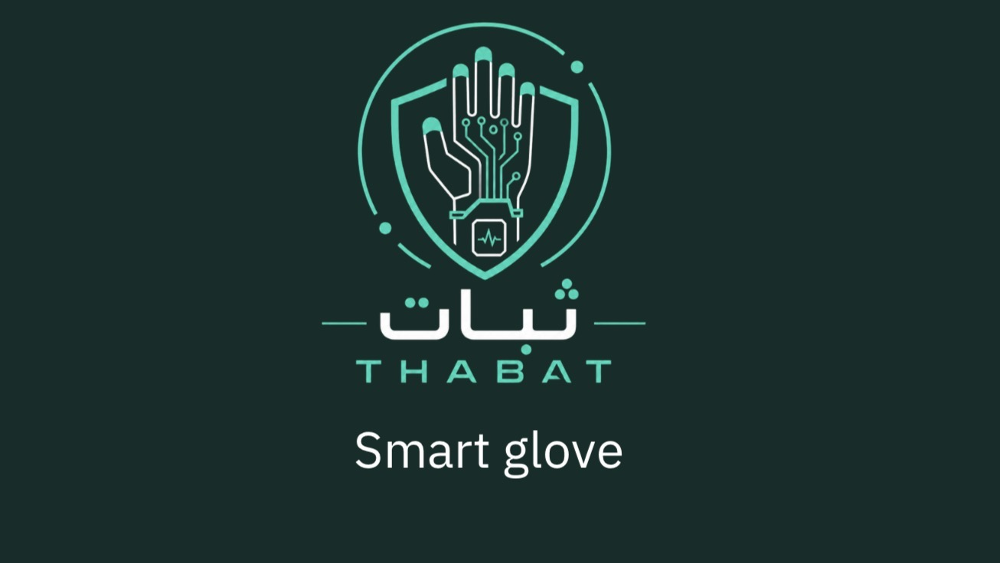

 

### Smart Glove–Integrated Mixed Reality Training System

An AI-enhanced immersive training system for Explosive Ordnance Disposal (EOD).

 

<strong>Unity · Mixed Reality · Smart Wearables · AI Integration</strong>

  

<strong>3rd Place — Education Track | Defensathon 2026</strong>

 

---

## Overview

THABAT is a smart glove-integrated Mixed Reality (MR) training prototype developed to explore immersive approaches to Explosive Ordnance Disposal (EOD) training.

The system brings together a Unity-based simulation environment, wearable sensing technology, and AI-assisted analysis to support interactive, scenario-based training.

Developed during Defensathon 2026, THABAT demonstrates the potential of combining immersive technologies and intelligent systems in specialized training environments.
